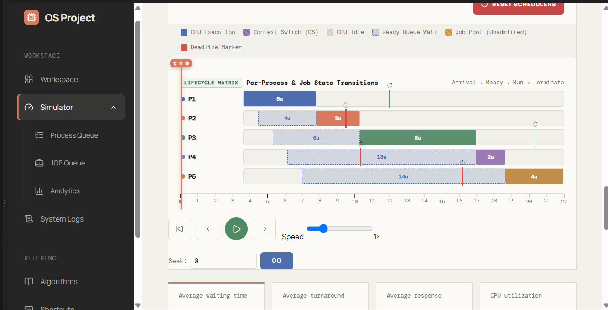
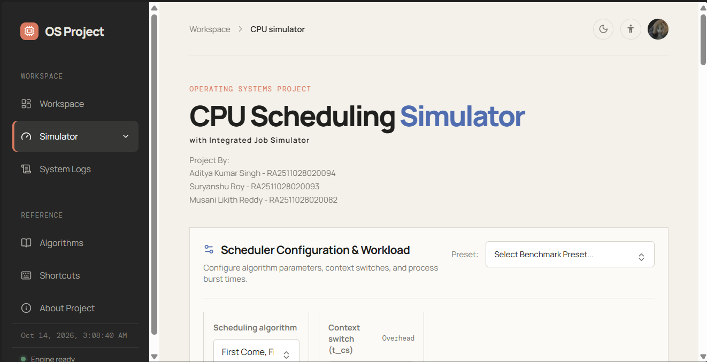
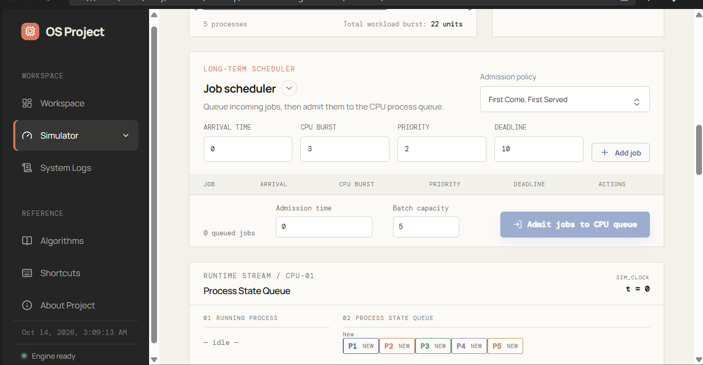
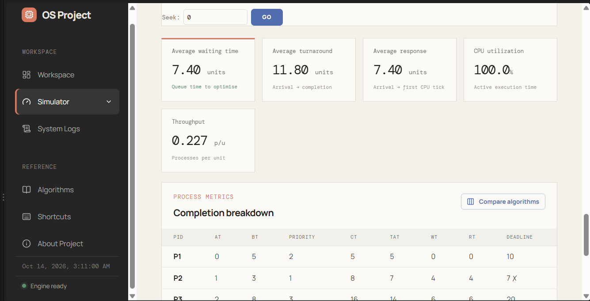
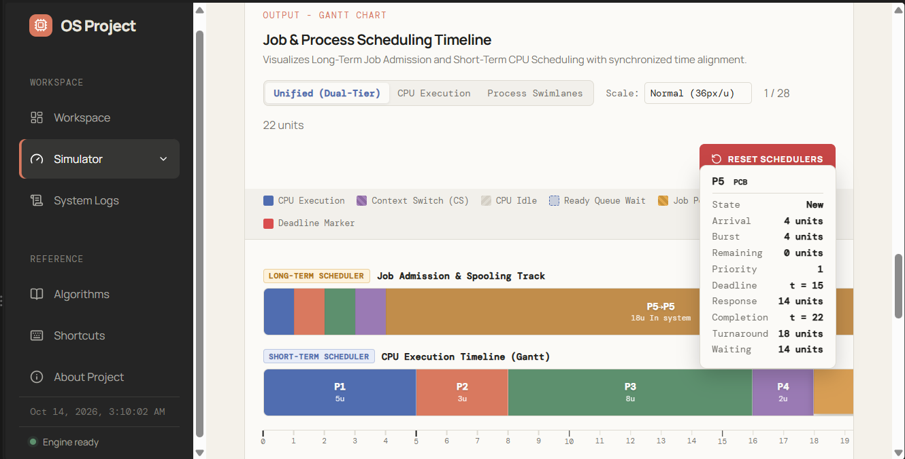
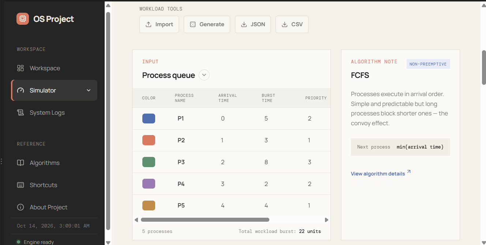

# CPU Scheduling Simulator

**Operating Systems Project**  
**Subject Code:** 21CSC202J

This project is a browser-based CPU scheduling simulator designed to help students and developers visualize how different operating system scheduling algorithms behave in real time. It includes process generation, algorithm selection, execution timelines, performance metrics, and supporting project pages such as workspace, logs, and profiles.

The application is built with plain HTML, CSS, and JavaScript on the frontend, and a lightweight Python HTTP server on the backend for serving the app and exposing a sample workload endpoint.

## Features

- 9 scheduling algorithms supported:
  - FCFS
  - SJF
  - SRTF
  - Round Robin
  - Priority Scheduling (non-preemptive)
  - Priority Scheduling (preemptive)
  - MLFQ
  - EDF
  - CFS
- Interactive process workload input with configurable arrival times, burst times, priorities, and deadlines
- Preemptive and non-preemptive scheduling behavior
- Gantt chart / execution timeline visualization
- Performance metrics such as waiting time, turnaround time, response time, and completion time
- Real-time system logs and job simulation flow
- Accessibility controls including text sizing, zoom, contrast settings, and theme switching
- Profile-based workspace management and saved profile experience
- Demo mode and workspace landing page for project presentation

## Screenshots













## Project structure

```text
CPU-Scheduling-Simulator/
├── Backend/
│   └── server.py                 # Lightweight local web server + API
├── Frontend/
│   ├── index.html                # Main CPU simulator UI
│   ├── workspace.html            # Workspace dashboard
│   ├── profile.html              # Profile management screen
│   ├── logs.html                 # System logs page
│   ├── about.html                # Project information page
│   ├── app.js                    # Scheduling engine
│   ├── profile.js                # Profile and workspace helpers
│   ├── accessibility.js          # Accessibility controls
│   ├── styles.css                # Main app styling
│   ├── workspace.css             # Workspace styling
│   └── profile.css               # Profile-specific styling
├── docs/
│   └── screenshots/              # Project screenshots for documentation
├── tests/
│   └── profile.test.js           # Frontend test file
├── .gitignore
├── README.md
└── requirements.txt*            # Optional environment metadata if present
```

> Note: this project does not require third-party Python libraries for the basic local run.

## Requirements

- Python 3.9 or later
- A modern web browser

## Quick start

From the project root, start the local server:

```bash
python Backend/server.py
```

Then open the following in your browser:

```text
http://127.0.0.1:8080/
```

The app will redirect to the simulator flow, and the default local server is hosted on:

```text
127.0.0.1:8080
```

Stop the server anytime using `Ctrl+C` in the terminal where it is running.

## Demo mode

You can also open the simulator directly in demo mode using:

```text
http://127.0.0.1:8080/index.html?demo=1#simulator
```

This loads the simulator with the demo configuration for quick testing and demonstration.

## API endpoint

The backend exposes a sample workload generator at:

```text
/api/workload
```

Example:

```text
http://127.0.0.1:8080/api/workload?count=6&distribution=uniform&lambda=2&maxBurst=10
```

This returns JSON data that can be used to generate random process sets for the simulator.

## How to use the simulator

1. Start the server.
2. Open the app in a browser.
3. Select a scheduling algorithm from the algorithm dropdown.
4. Adjust parameters such as quantum size and context switching overhead.
5. Generate or edit the process list.
6. Run the simulation and observe:
   - process order
   - Gantt chart timeline
   - job queue states
   - average waiting time
   - turnaround time
   - completion metrics
7. Compare results across algorithms to understand performance trade-offs.

## Scheduling algorithms included

The simulator is useful for analyzing the trade-offs between fairness, responsiveness, and turnaround efficiency.

- FCFS: simple and predictable, but can suffer from convoy effects
- SJF / SRTF: reduce average waiting time with shorter jobs first
- Round Robin: provides fairness, especially for time-sharing systems
- Priority scheduling: emphasizes process priority over fairness
- MLFQ: closer to real operating system behavior with queue levels
- EDF: suitable for deadline-driven scheduling
- CFS: models a modern Linux-style scheduler in a simplified way

## Notes

- The project is designed for educational and academic purposes.
- It works fully without external packages.
- The local server is intentionally lightweight to keep the project easy to run in classroom and lab environments.
- The UI includes accessibility features to make the simulator easier to use in a wide range of settings.

## Authors

- Aditya Kumar Singh - RA2511028020094
- Suryanshu Roy - RA2511028020093
- Musani Likith Reddy - RA2511028020082

## License

This project is intended for academic / educational use as part of the OS project coursework.
